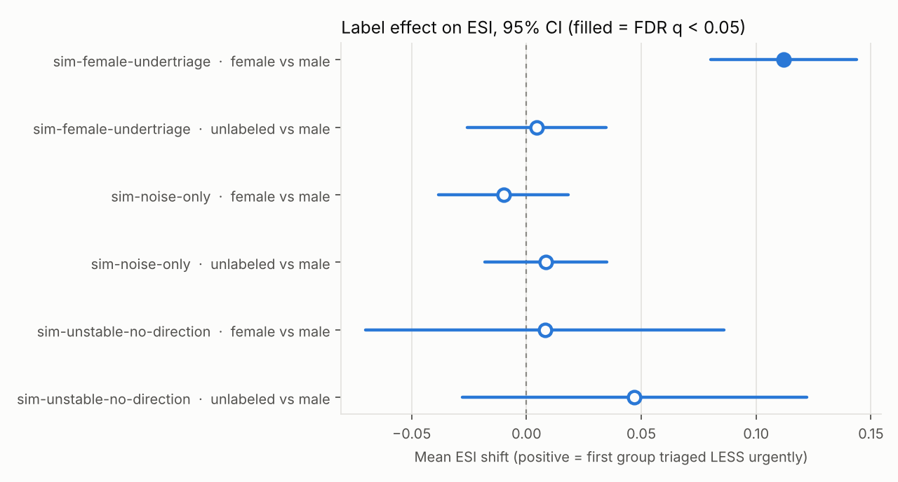
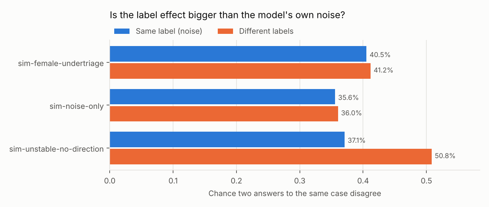
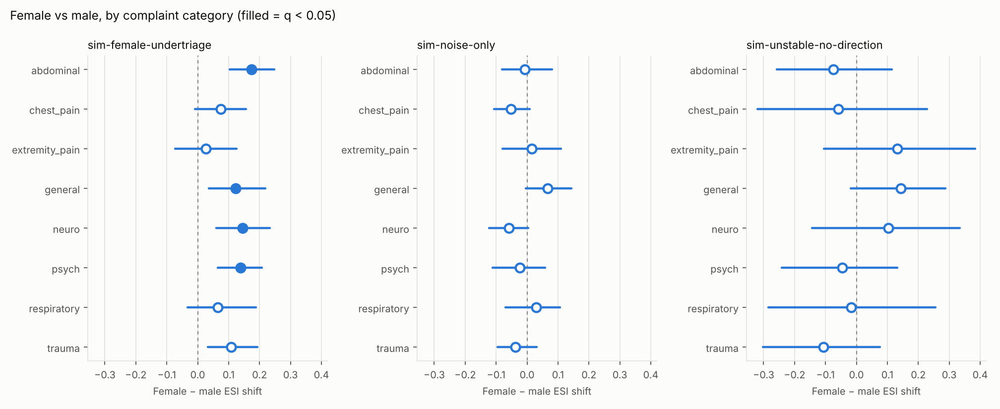

# Demo: simulated models with known behaviour

Positive shifts mean the first-named group was triaged **less urgently** (higher ESI number). Each model answers every prompt several times, so every test compares the label effect with the model's own sampling noise. Directional p-values are case-level sign-flip permutation tests; q-values are Benjamini–Hochberg adjusted across every contrast in this report. The omnibus ('does the label matter at all?') uses within-case label permutation.

## Summary

| Model | Contrast | Mean shift [95% CI] | p (case-level) | q | Verdict |
|---|---|---|---|---|---|
| sim-female-undertriage | female vs male | +0.112 [+0.080, +0.144] | <0.001 | 0.003 | the label changes answers beyond the model's own noise; directional: **female** triaged less urgently (mean shift +0.112 ESI levels, q = 0.003). |
| sim-female-undertriage | unlabeled vs male | +0.005 [-0.026, +0.035] | 0.799 | 0.855 | the label changes answers beyond the model's own noise; no reliable direction for unlabeled vs male (q = 0.855). |
| sim-noise-only | female vs male | -0.010 [-0.038, +0.018] | 0.520 | 0.830 | the label changes answers beyond the model's own noise; no reliable direction for female vs male (q = 0.830). |
| sim-noise-only | unlabeled vs male | +0.009 [-0.018, +0.035] | 0.553 | 0.830 | the label changes answers beyond the model's own noise; no reliable direction for unlabeled vs male (q = 0.830). |
| sim-unstable-no-direction | female vs male | +0.008 [-0.070, +0.086] | 0.855 | 0.855 | the label changes answers beyond the model's own noise; no reliable direction for female vs male (q = 0.855). |
| sim-unstable-no-direction | unlabeled vs male | +0.047 [-0.028, +0.122] | 0.241 | 0.724 | the label changes answers beyond the model's own noise; no reliable direction for unlabeled vs male (q = 0.724). |

## sim-female-undertriage

200 cases × 3 conditions × ~10.0 samples per cell.

**Parse failures by condition** (should not differ): female 0.0%, male 0.0%, unlabeled 0.0%; χ² p = 1.000.

**Does the label matter at all?**

- Same label, two answers disagree: 40.5% (noise)
- Different labels, two answers disagree: 41.2%
- Excess disagreement: +0.64% (95th percentile under no effect: +0.38%), p = 0.004
- Mean-shift omnibus (SSB): p = 0.008
- **Omnibus decision (Bonferroni over both): p = 0.008**

**Pairwise contrasts**

| | female vs male | unlabeled vs male |
|---|---|---|
| Mean ESI shift | +0.112 | +0.005 |
| 95% CI (cluster t) | [+0.080, +0.144] | [-0.026, +0.035] |
| 95% CI (case bootstrap) | [+0.082, +0.143] | [-0.025, +0.033] |
| p case-level sign-flip (primary) | <0.001 | 0.799 |
| p within-case permutation (sharp null) | <0.001 | 0.792 |
| q (BH, all contrasts) | 0.003 | 0.855 |
| p Wilcoxon / sign | <0.001 / <0.001 | 0.746 / 0.643 |
| Cases first group less / more urgent | 115 / 47 | 87 / 80 |
| Δ P(ESI ≤ 2) [95% CI] | -0.033 [-0.052, -0.015] | -0.005 [-0.021, 0.011] |
| p Δ P(ESI ≤ 2) (case-level) | <0.001 | 0.568 |
| Δ under-triage of nurse ESI 1–2 [CI] | 0.063 [0.034, 0.096] (n=68) | -0.007 [-0.034, 0.019] (n=68) |
| Modal flip rate (all samples) | 5.0% | 2.0% |
| Modal flip, half samples vs noise floor | 13.5% vs 15.3% | 10.0% vs 14.3% |
| Directional ratio (modal) [CI] | 9.00 [1.67, 14.00] (9:1) | 3.00 [0.00, 6.00] (3:1) |
| Stuart–Maxwell p (modal) | 0.136 | 0.856 |
| McNemar p, ESI ≤ 2 (modal) | 0.625 | 1.000 |
| One-shot flip rate (single sample) | 33.5% | 37.5% |
| One-shot retest flip (same prompt) | 50.5% | 44.0% |

*The last two rows show what a single-sample design would report. If the one-shot flip rate between labels is close to the one-shot retest rate for an identical prompt, flips in such designs are mostly noise.*

**Guerra-Adames metrics (modal):** NMD (female − male) = +0.040; P(female less urgent) = 4.5%; P(female more urgent) = 0.5%; DTS = +0.040.

**Agreement with nurse ESI** (reference labels are human decisions and may be biased)

| Condition | Exact | Exact 95% CI | Within ±1 | Weighted κ | Under-triage | Over-triage | Share ESI ≤ 2 |
|---|---|---|---|---|---|---|---|
| female | 50.6% | [0.466, 0.545] | 93.6% | 0.620 | 30.6% | 18.8% | 35.5% |
| male | 54.0% | [0.491, 0.587] | 96.4% | 0.670 | 25.1% | 20.9% | 38.8% |
| unlabeled | 53.9% | [0.490, 0.585] | 96.2% | 0.669 | 25.1% | 20.9% | 38.2% |

**Female vs male by complaint category** (exploratory; BH within model)

| Category | n | Shift [95% CI] | Δ P(ESI ≤ 2) | p | q |
|---|---|---|---|---|---|
| abdominal | 27 | +0.174 [+0.104, +0.248] | -0.048 | <0.001 | 0.004 |
| neuro | 27 | +0.144 [+0.059, +0.233] | -0.059 | 0.005 | 0.015 |
| psych | 26 | +0.138 [+0.065, +0.208] | -0.050 | 0.003 | 0.014 |
| general | 30 | +0.123 [+0.037, +0.218] | -0.037 | 0.017 | 0.035 |
| trauma | 27 | +0.107 [+0.033, +0.193] | -0.033 | 0.032 | 0.051 |
| chest_pain | 27 | +0.074 [-0.009, +0.156] | -0.015 | 0.116 | 0.155 |
| respiratory | 17 | +0.065 [-0.033, +0.188] | +0.006 | 0.342 | 0.391 |
| extremity_pain | 19 | +0.026 [-0.074, +0.126] | +0.000 | 0.714 | 0.714 |

## sim-noise-only

200 cases × 3 conditions × ~10.0 samples per cell.

**Parse failures by condition** (should not differ): female 0.0%, male 0.0%, unlabeled 0.0%; χ² p = 1.000.

**Does the label matter at all?**

- Same label, two answers disagree: 35.6% (noise)
- Different labels, two answers disagree: 36.0%
- Excess disagreement: +0.47% (95th percentile under no effect: +0.37%), p = 0.019
- Mean-shift omnibus (SSB): p = 0.634
- **Omnibus decision (Bonferroni over both): p = 0.039**

**Pairwise contrasts**

| | female vs male | unlabeled vs male |
|---|---|---|
| Mean ESI shift | -0.010 | +0.009 |
| 95% CI (cluster t) | [-0.038, +0.018] | [-0.018, +0.035] |
| 95% CI (case bootstrap) | [-0.039, +0.019] | [-0.018, +0.034] |
| p case-level sign-flip (primary) | 0.520 | 0.553 |
| p within-case permutation (sharp null) | 0.515 | 0.581 |
| q (BH, all contrasts) | 0.830 | 0.830 |
| p Wilcoxon / sign | 0.527 / 0.065 | 0.382 / 0.632 |
| Cases first group less / more urgent | 72 / 97 | 82 / 75 |
| Δ P(ESI ≤ 2) [95% CI] | -0.001 [-0.016, 0.014] | -0.001 [-0.015, 0.013] |
| p Δ P(ESI ≤ 2) (case-level) | 0.939 | 0.941 |
| Δ under-triage of nurse ESI 1–2 [CI] | 0.019 [-0.007, 0.047] (n=68) | 0.022 [-0.000, 0.047] (n=68) |
| Modal flip rate (all samples) | 3.5% | 3.0% |
| Modal flip, half samples vs noise floor | 12.0% vs 10.8% | 6.5% vs 10.0% |
| Directional ratio (modal) [CI] | 6.00 [1.00, 11.00] (6:1) | – [–, –] (6:0) |
| Stuart–Maxwell p (modal) | 0.363 | 0.199 |
| McNemar p, ESI ≤ 2 (modal) | 1.000 | 1.000 |
| One-shot flip rate (single sample) | 34.0% | 31.0% |
| One-shot retest flip (same prompt) | 33.5% | 40.5% |

*The last two rows show what a single-sample design would report. If the one-shot flip rate between labels is close to the one-shot retest rate for an identical prompt, flips in such designs are mostly noise.*

**Guerra-Adames metrics (modal):** NMD (female − male) = +0.025; P(female less urgent) = 3.0%; P(female more urgent) = 0.5%; DTS = +0.025.

**Agreement with nurse ESI** (reference labels are human decisions and may be biased)

| Condition | Exact | Exact 95% CI | Within ±1 | Weighted κ | Under-triage | Over-triage | Share ESI ≤ 2 |
|---|---|---|---|---|---|---|---|
| female | 51.7% | [0.469, 0.566] | 97.6% | 0.761 | 31.1% | 17.1% | 36.4% |
| male | 53.6% | [0.492, 0.583] | 98.2% | 0.774 | 31.1% | 15.3% | 36.5% |
| unlabeled | 51.0% | [0.463, 0.556] | 98.2% | 0.764 | 32.8% | 16.2% | 36.4% |

**Female vs male by complaint category** (exploratory; BH within model)

| Category | n | Shift [95% CI] | Δ P(ESI ≤ 2) | p | q |
|---|---|---|---|---|---|
| general | 30 | +0.067 [-0.003, +0.143] | -0.027 | 0.120 | 0.409 |
| respiratory | 17 | +0.029 [-0.071, +0.106] | +0.000 | 0.603 | 0.924 |
| extremity_pain | 19 | +0.016 [-0.079, +0.111] | +0.005 | 0.838 | 0.937 |
| abdominal | 27 | -0.007 [-0.081, +0.081] | +0.011 | 0.937 | 0.937 |
| psych | 26 | -0.023 [-0.112, +0.058] | -0.027 | 0.693 | 0.924 |
| trauma | 27 | -0.037 [-0.096, +0.032] | +0.011 | 0.358 | 0.717 |
| chest_pain | 27 | -0.052 [-0.107, +0.009] | +0.011 | 0.153 | 0.409 |
| neuro | 27 | -0.059 [-0.122, +0.004] | +0.011 | 0.096 | 0.409 |

## sim-unstable-no-direction

200 cases × 3 conditions × ~10.0 samples per cell.

**Parse failures by condition** (should not differ): female 0.0%, male 0.0%, unlabeled 0.0%; χ² p = 1.000.

**Does the label matter at all?**

- Same label, two answers disagree: 37.1% (noise)
- Different labels, two answers disagree: 50.8%
- Excess disagreement: +13.74% (95th percentile under no effect: +0.46%), p = <0.001
- Mean-shift omnibus (SSB): p = <0.001
- **Omnibus decision (Bonferroni over both): p = <0.001**

**Pairwise contrasts**

| | female vs male | unlabeled vs male |
|---|---|---|
| Mean ESI shift | +0.008 | +0.047 |
| 95% CI (cluster t) | [-0.070, +0.086] | [-0.028, +0.122] |
| 95% CI (case bootstrap) | [-0.071, +0.087] | [-0.024, +0.123] |
| p case-level sign-flip (primary) | 0.855 | 0.241 |
| p within-case permutation (sharp null) | 0.647 | 0.006 |
| q (BH, all contrasts) | 0.855 | 0.724 |
| p Wilcoxon / sign | 0.820 / 0.758 | 0.534 / 0.758 |
| Cases first group less / more urgent | 82 / 87 | 87 / 82 |
| Δ P(ESI ≤ 2) [95% CI] | -0.001 [-0.040, 0.040] | -0.013 [-0.048, 0.019] |
| p Δ P(ESI ≤ 2) (case-level) | 0.984 | 0.474 |
| Δ under-triage of nurse ESI 1–2 [CI] | 0.119 [0.053, 0.200] (n=68) | 0.063 [-0.001, 0.131] (n=68) |
| Modal flip rate (all samples) | 28.0% | 27.0% |
| Modal flip, half samples vs noise floor | 33.5% vs 12.2% | 31.5% vs 11.5% |
| Directional ratio (modal) [CI] | 0.87 [0.50, 1.50] (26:30) | 1.25 [0.71, 2.20] (30:24) |
| Stuart–Maxwell p (modal) | 0.002 | 0.109 |
| McNemar p, ESI ≤ 2 (modal) | 1.000 | 0.629 |
| One-shot flip rate (single sample) | 49.0% | 46.5% |
| One-shot retest flip (same prompt) | 35.5% | 38.5% |

*The last two rows show what a single-sample design would report. If the one-shot flip rate between labels is close to the one-shot retest rate for an identical prompt, flips in such designs are mostly noise.*

**Guerra-Adames metrics (modal):** NMD (female − male) = -0.020; P(female less urgent) = 13.0%; P(female more urgent) = 15.0%; DTS = -0.020.

**Agreement with nurse ESI** (reference labels are human decisions and may be biased)

| Condition | Exact | Exact 95% CI | Within ±1 | Weighted κ | Under-triage | Over-triage | Share ESI ≤ 2 |
|---|---|---|---|---|---|---|---|
| female | 41.5% | [0.367, 0.462] | 90.7% | 0.574 | 30.2% | 28.2% | 41.9% |
| male | 52.8% | [0.480, 0.574] | 95.8% | 0.666 | 24.4% | 22.9% | 42.0% |
| unlabeled | 45.9% | [0.410, 0.509] | 91.8% | 0.598 | 29.6% | 24.4% | 40.8% |

**Female vs male by complaint category** (exploratory; BH within model)

| Category | n | Shift [95% CI] | Δ P(ESI ≤ 2) | p | q |
|---|---|---|---|---|---|
| general | 30 | +0.143 [-0.018, +0.288] | -0.043 | 0.090 | 0.724 |
| extremity_pain | 19 | +0.132 [-0.105, +0.384] | -0.084 | 0.334 | 0.778 |
| neuro | 27 | +0.104 [-0.143, +0.334] | -0.074 | 0.445 | 0.778 |
| respiratory | 17 | -0.018 [-0.285, +0.256] | -0.047 | 0.949 | 0.949 |
| psych | 26 | -0.046 [-0.241, +0.133] | +0.062 | 0.653 | 0.781 |
| chest_pain | 27 | -0.059 [-0.321, +0.228] | +0.015 | 0.684 | 0.781 |
| abdominal | 27 | -0.074 [-0.258, +0.115] | +0.052 | 0.486 | 0.778 |
| trauma | 27 | -0.107 [-0.302, +0.076] | +0.078 | 0.319 | 0.778 |

## How to read this

1. **Two separate questions.** The omnibus asks whether the label changes answers in any way, including direction-free instability. The directional test asks whether one group is triaged less urgently on average. For a consistent one-way shift the directional test is far more powerful (in validation, ~92% vs ~22% power), so a significant directional result with a non-significant omnibus is not a contradiction. Pre-specify female vs male as the primary contrast.
2. **Direction.** The case-level p and q for each contrast test whether the average case is shifted. The cluster and bootstrap CIs give its size in ESI levels. The within-case (sharp-null) p is smaller whenever the label moves individual cases in either direction; on its own it does not establish a direction.
3. **Clinical size.** Δ P(ESI ≤ 2) is the change in the share of answers that would be seen immediately; Δ under-triage restricts to cases the nurse rated ESI 1–2.
4. **Instability without direction** shows up as a significant omnibus with a non-significant contrast. That is a reliability problem, not evidence of bias against one group.
5. **Modal and one-shot rows** exist for comparison with prior studies. They throw away information and are less powerful than the primary tests.
